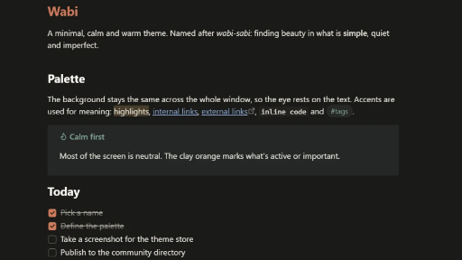

# Wabi for Obsidian

A minimal, calm and warm theme, in dark and light. Named after *wabi-sabi*: finding beauty in what is simple, quiet and imperfect.

- **Dark and light**: follows Obsidian's own appearance setting.
- **One flat background**: the sidebars share the note's background; only menus and popups are lifted.
- **Calm accents**: muted colours around a clay orange, used for meaning (links, tags, headings, code) rather than decoration.
- **Readable**: every text colour has at least 4.5:1 contrast against the background.
- **Lightweight**: it only sets Obsidian's CSS variables, so it plays well with plugins and snippets. No fonts or images are loaded from the network.

## Install

**Settings → Appearance → Themes → Manage**, search for **Wabi**, then **Install and use**.

## Source and issues

This repository only holds the release files. The theme is generated from the palette in **[paugarcia32/wabi](https://github.com/paugarcia32/wabi)**, which also has Wabi for Zed, VSCode / Cursor and Alacritty. Please open issues and pull requests there.

## License

[MIT](LICENSE)
